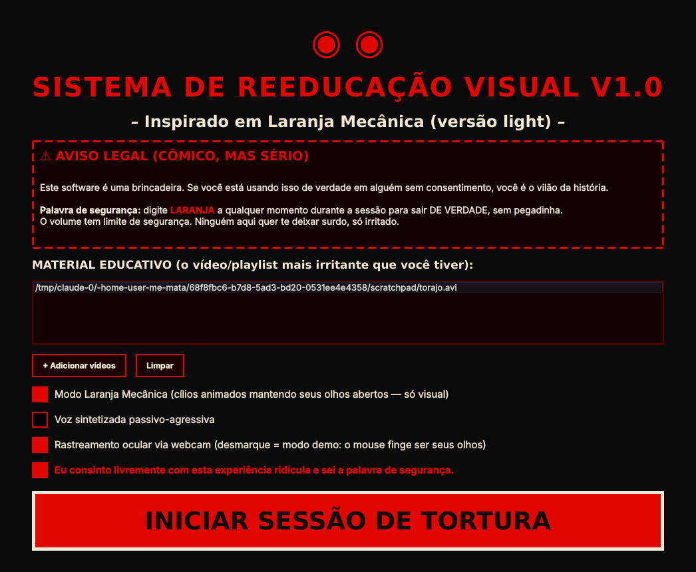
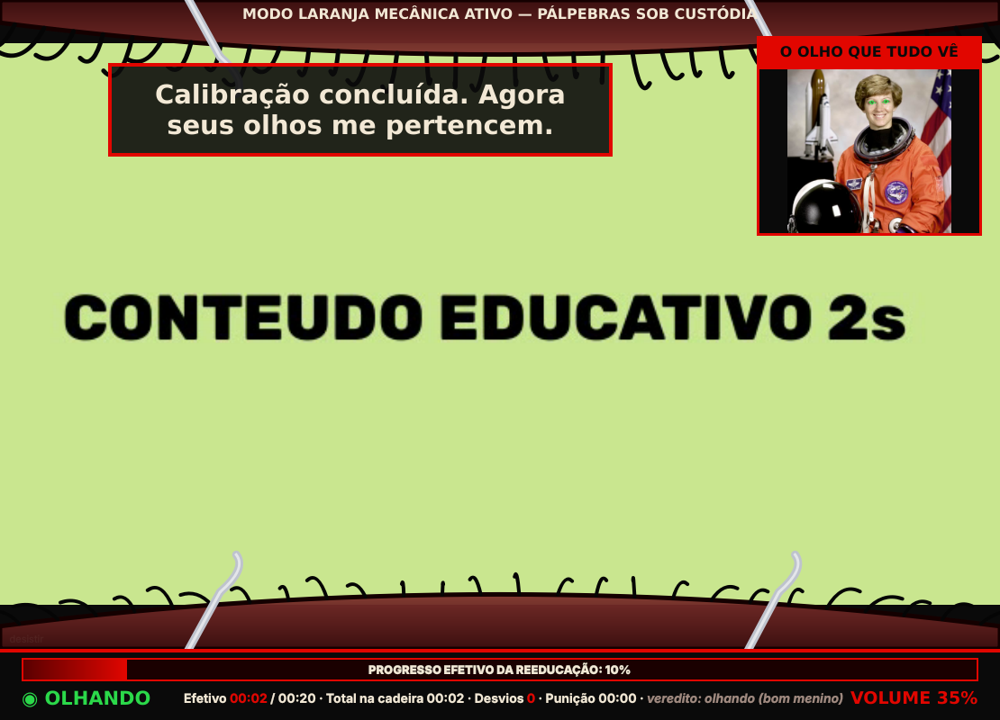
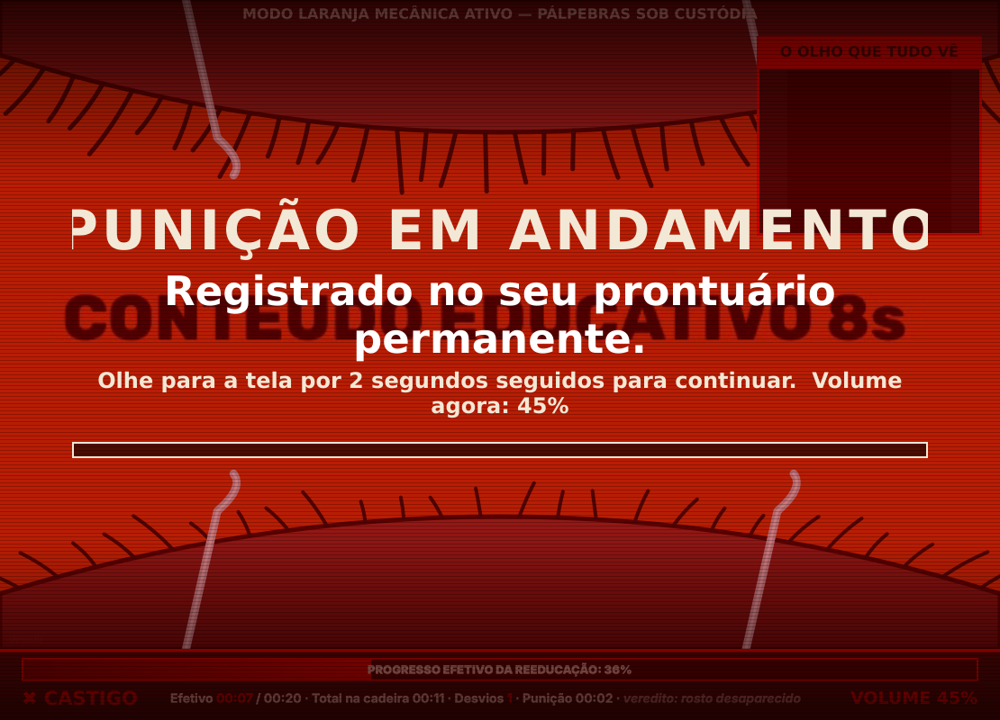
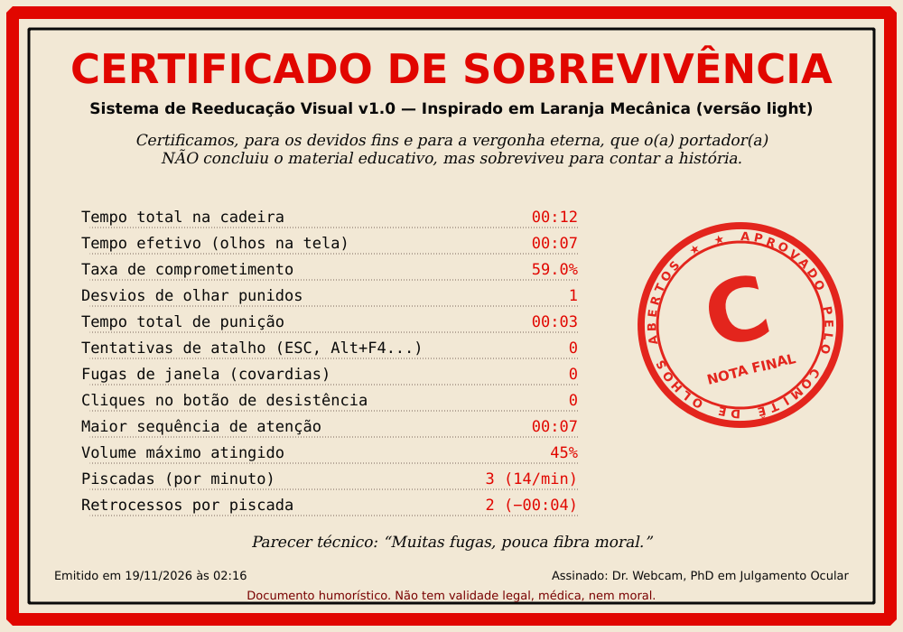

# 👁️👁️ Sistema de Reeducação Visual v1.0
### *Inspirado em Laranja Mecânica (versão light)*

> ⚠️ **ISTO É UMA BRINCADEIRA.** Software de humor, para uma experiência interativa
> **consentida**. Se você está usando isso de verdade em alguém sem consentimento,
> você é o vilão da história.
>
> 🍊 **Palavra de segurança:** digite **`LARANJA`** a qualquer momento da sessão para
> sair de verdade. Sem pegadinha.

Um app desktop (Python + PyQt6) que obriga você a assistir a um vídeo até o fim, sem pular,
pausar ou acelerar, e usa **rastreamento ocular real pela webcam** (OpenCV + MediaPipe) para
conferir se você está mesmo olhando para a tela. Desviou o olhar? O vídeo pausa, a tela fica
vermelha, o volume sobe e um software julga você.

| Tela inicial | Sessão (olhando) |
|---|---|
|  |  |
| **Punição** | **Certificado** |
|  |  |

*(capturas feitas com uma foto de teste no lugar da webcam)*

---

## Instalação

```bash
cd reeducacao_visual
python -m venv .venv && source .venv/bin/activate   # Windows: .venv\Scripts\activate
pip install -r requirements.txt
python -m rv.model        # baixa o modelo de rosto (~3.7 MB) uma única vez
```

Depois de baixado o modelo, **tudo roda offline**.

## Uso

```bash
python main.py                              # tela inicial dramática
python main.py --video torajo.mp4           # já pré-seleciona o vídeo
python main.py --video ep1.mp4 ep2.mp4      # playlist
python main.py --sem-webcam                 # modo demo: o cursor do mouse finge ser seus olhos (botão direito = piscar)
python main.py --camera 1                   # outra webcam
python main.py --sem-voz --sem-laranja      # sem voz / sem o overlay de cílios
python main.py --piscou-voltou              # Modo Pálpebra Proibida: cada piscada volta 10 s
python main.py --direto --video x.mp4       # pula a tela inicial
```

Quer usar uma playlist do YouTube? Baixe antes (ex.: `yt-dlp`) e passe os arquivos;
o app é offline de propósito.

## O que acontece na sessão

| Situação | Punição |
|---|---|
| Desviou o olhar por mais de **1,5 s** | Vídeo pausa, overlay vermelho com mensagem aleatória, **volume +10%** (limite de segurança: 80%) |
| Quer voltar | Precisa olhar para a tela por **2 s seguidos** (tem barrinha de redenção) |
| ESC, espaço, setas, Alt+F4, Ctrl+W, Ctrl+Q... | Bloqueados; cada um rende uma mensagem sarcástica |
| Minimizar / trocar de janela | Pausa + *"Covarde detectado. Voltando à terapia..."* e a janela tenta voltar |
| Botão de desistência escondido (procure no canto) | *"Fraqueza detectada. Reiniciando o vídeo do zero."* |
| Fechou os olhos | Conta como desvio. Piscar é tolerado; dormir não |
| Piscou | Sempre entra no **contador de piscadas** (HUD e certificado). No **Modo Pálpebra Proibida** (opção na tela inicial ou `--piscou-voltou`), cada piscada **volta o vídeo 10 s** e desconta do progresso. Durante a punição o vídeo já está pausado, então a piscada só é contada |
| Digitou `LARANJA` | Sai de verdade e recebe o certificado de **Desistência Honrosa** |

A **barra de progresso** só avança enquanto seus olhos estão na tela e o vídeo está rodando.
O período de tolerância de 1,5 s não conta. No final sai um **Certificado de Sobrevivência**
(dá para salvar em PNG) com tempo total, tempo efetivo, taxa de comprometimento, desvios,
tempo de punição, tentativas de fuga, maior sequência de atenção, volume máximo e uma nota
de S+ a F, além de piscadas por minuto e segundos perdidos piscando.

**Extras:** voz sintetizada passivo-agressiva (QtTextToSpeech ou `pyttsx3`, se houver engine
instalada) e o **Modo Laranja Mecânica**: pálpebras gigantes presas por grampos com cílios
tremendo nas bordas da tela. São só pixels, ninguém encosta no seu olho.

## Como funciona o rastreamento ocular

`rv/gaze.py` roda a webcam numa `QThread` e passa cada frame pelo **MediaPipe FaceLandmarker**
(478 landmarks com íris, 52 blendshapes e a matriz de pose da cabeça). Daí saem:

- **yaw / pitch da cabeça**, pela decomposição da matriz de rotação (`cv2.RQDecomp3x3`);
- **posição horizontal da íris**, projetando o centro da íris (468/473) no segmento entre os cantos do olho;
- **olhar para cima/baixo**, pelos blendshapes `eyeLookUp*` / `eyeLookDown*`;
- **olho fechado**, pelo blendshape `eyeBlink*`;
- **piscadas**, por um detector à parte (`BlinkDetector`) que lê o valor bruto de `eyeBlink*` com histerese. Fechar e reabrir em até 0,6 s conta como piscada; fechar por mais tempo é cochilo e cai na regra de desvio.

Antes do vídeo há uma **calibração** de 3 s (você encara um alvo no centro). Todas as métricas
são comparadas com essa referência, porque a webcam quase nunca fica no centro do monitor.
Os sinais passam por média móvel exponencial, e a decisão "olhando / não olhando" alimenta a
máquina de estados de `rv/attention.py` (`WATCHING → GRACE → PUNISHED → RECOVERING`).

Os limiares ficam em `rv/config.py` (`MAX_YAW_DEG`, `MAX_IRIS_H_OFFSET`, etc.). Se ficar
sensível demais ou de menos para a sua webcam, ajuste ali. As mensagens também estão lá.

## Limites (de propósito)

É uma brincadeira, não um malware. O app:
- **não** instala hooks de teclado no sistema, **não** bloqueia Ctrl+Alt+Del nem o gerenciador de tarefas;
- bloqueia atalhos **apenas dentro da própria janela**;
- tenta recuperar o foco ao trocar de janela, mas no Wayland isso pode não funcionar (o vídeo continua pausado mesmo assim);
- tem limite de volume e palavra de segurança que **sempre** funciona.

## Estrutura

```
main.py              ponto de entrada (argparse)
rv/config.py         tempos, limiares, cores e TODAS as mensagens
rv/attention.py      máquina de estados da atenção (pura, testada)
rv/gaze.py           webcam + MediaPipe + classificação do olhar; modo demo com mouse
rv/stats.py          estatísticas e veredito final
rv/voice.py          voz sintetizada opcional
rv/model.py          download do modelo .task
rv/ui/splash.py      tela inicial dramática
rv/ui/session.py     a sessão inescapável
rv/ui/widgets.py     vídeo, overlay vermelho, cílios, toast, câmera
rv/ui/certificate.py certificado de sobrevivência
tests/               testes (python -m pytest)
```
